<div align="center">

# Charlie

### Boston in motion — a live, AI-assisted guide to the MBTA

Live arrivals, a real-time train map, door-to-door trip planning, honest service status and an assistant you can just ask.

[](https://charlie-mbta.vercel.app)


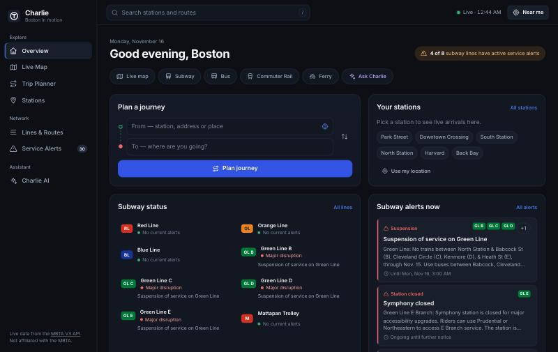

</div>

---

## Contents

- [Features](#features)
- [Screenshots](#screenshots)
- [How it works](#how-it-works)
- [Run it locally](#run-it-locally)
- [Tests](#tests)
- [Deployment](#deployment)
- [API reference](#api-reference)
- [Known limitations](#known-limitations)
- [MLOps pipeline (offline)](#mlops-pipeline-offline)
- [Acknowledgements](#acknowledgements)

---

## Features

| View | What you get |
|---|---|
| **Overview** | Greeting and live timestamp, a one-line subway status summary, a trip planner, live arrivals for your recent or nearest stations, the top subway alerts, and quick links to every mode. |
| **Live Map** | Full-screen dark map with MBTA line paths, all 126 stations and every subway and Green Line vehicle, color-coded and pointing in its direction of travel, refreshed about every 10 s. Line and layer filters, locate, fit-network, station search, and a route-focus mode for any route (e.g. `#/map?route=66`). |
| **Station details** | Opens as a side panel on desktop and a draggable bottom sheet on phones: served lines, accessibility, arrivals grouped by line and direction with large countdowns, and active alerts. |
| **Trip Planner** | Accessible station autocomplete (or free-text addresses), swap, use-my-location and recent trips. Options are ordered by total travel time and show segments, transfers, walking time, an estimated fare and alerts on the lines used. |
| **Stations** | Search all 126 subway and light-rail stations (partial, abbreviated and fuzzy matching) and filter by line. |
| **Lines & Routes** | Subway, Bus (searchable), Commuter Rail and Ferry. Each line page shows its station sequence with the next trains in both directions, alerts, the number of vehicles reporting, and a map shortcut. |
| **Service Alerts** | Prioritized by what affects riders now. Filters for all service, subway, bus, Commuter Rail and ferry, with accessibility (elevators, escalators) kept separate. Shows active periods, updates and links to the official alert. |
| **Charlie AI** | The original assistant (`/api/chat`) in a cleaner chat UI: suggestions, voice input, read-aloud, and tappable chips for stations and lines mentioned in replies. |

Built in: global search (press <kbd>/</kbd>), a live-data freshness indicator, keyboard support throughout, ARIA comboboxes, visible focus, WCAG-checked colors (line badges pick black or white text for contrast), and reduced-motion support.

---

## Screenshots

<table>
  <tr>
    <td width="50%">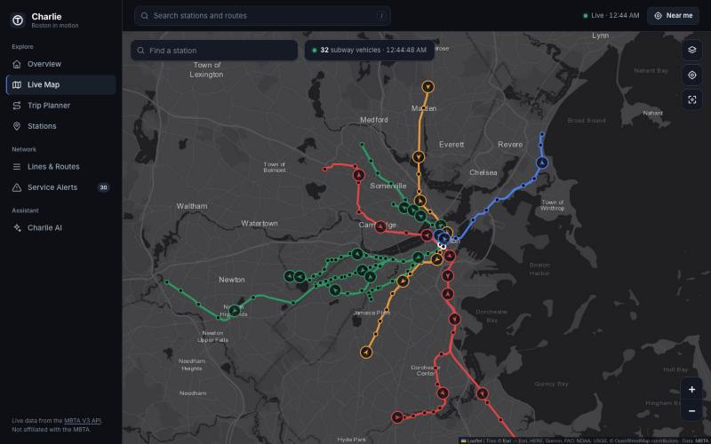<p align="center"><b>Live map</b> — line paths, stations and live vehicles</p></td>
    <td width="50%">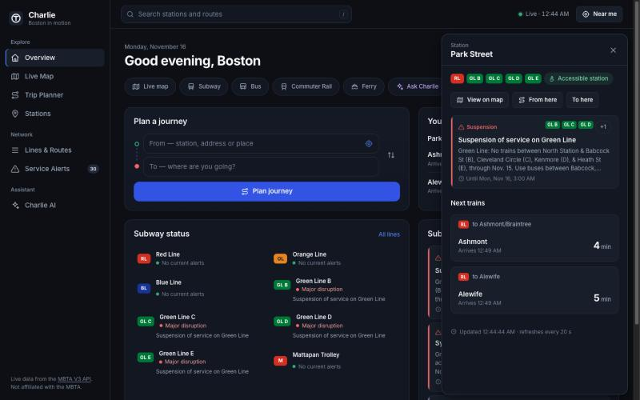<p align="center"><b>Station panel</b> — arrivals by direction, alerts, accessibility</p></td>
  </tr>
  <tr>
    <td width="50%">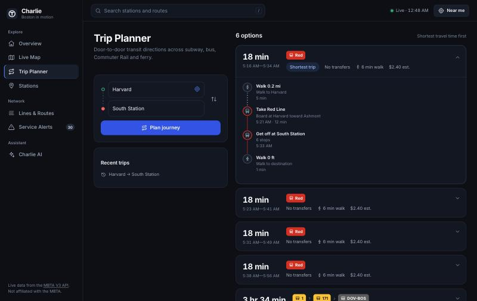<p align="center"><b>Trip planner</b> — shortest travel time first</p></td>
    <td width="50%">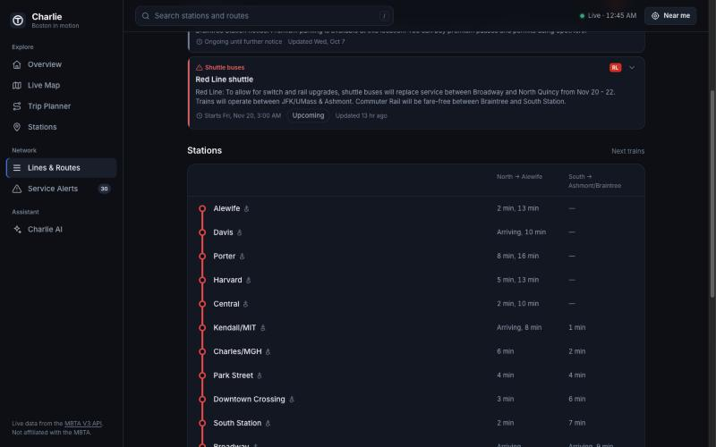<p align="center"><b>Line detail</b> — next trains at every station</p></td>
  </tr>
  <tr>
    <td width="50%">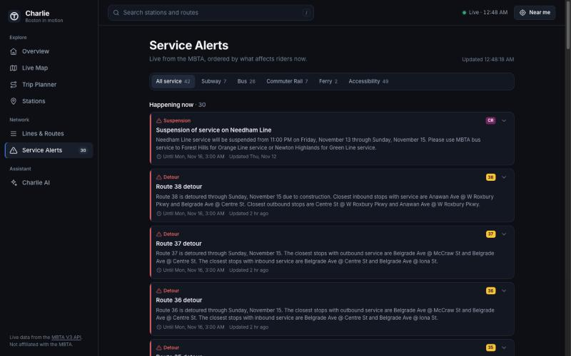<p align="center"><b>Service alerts</b> — filters with live counts</p></td>
    <td width="50%">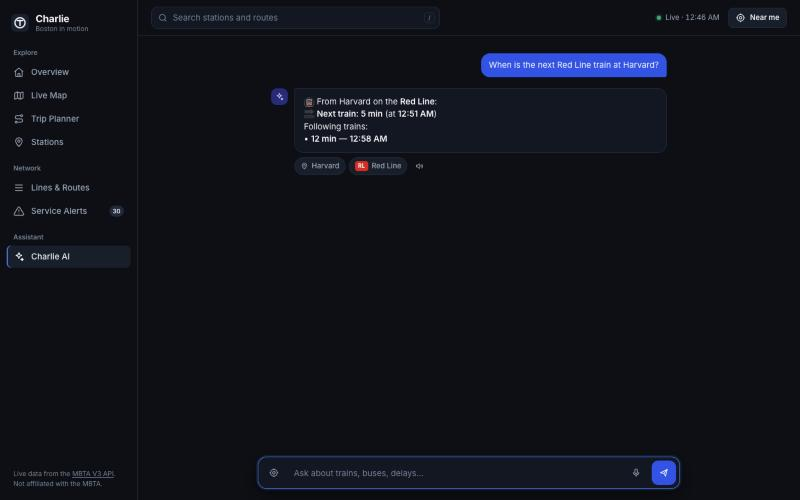<p align="center"><b>Charlie AI</b> — live answers with station and line chips</p></td>
  </tr>
</table>

<p align="center">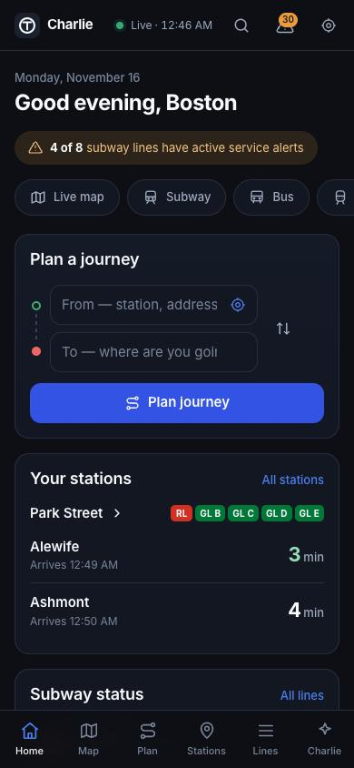</p>

<details>
<summary><b>Before the redesign</b></summary>

| Desktop | Tablet | Mobile |
|---|---|---|
| 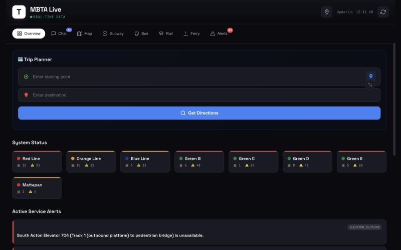 | 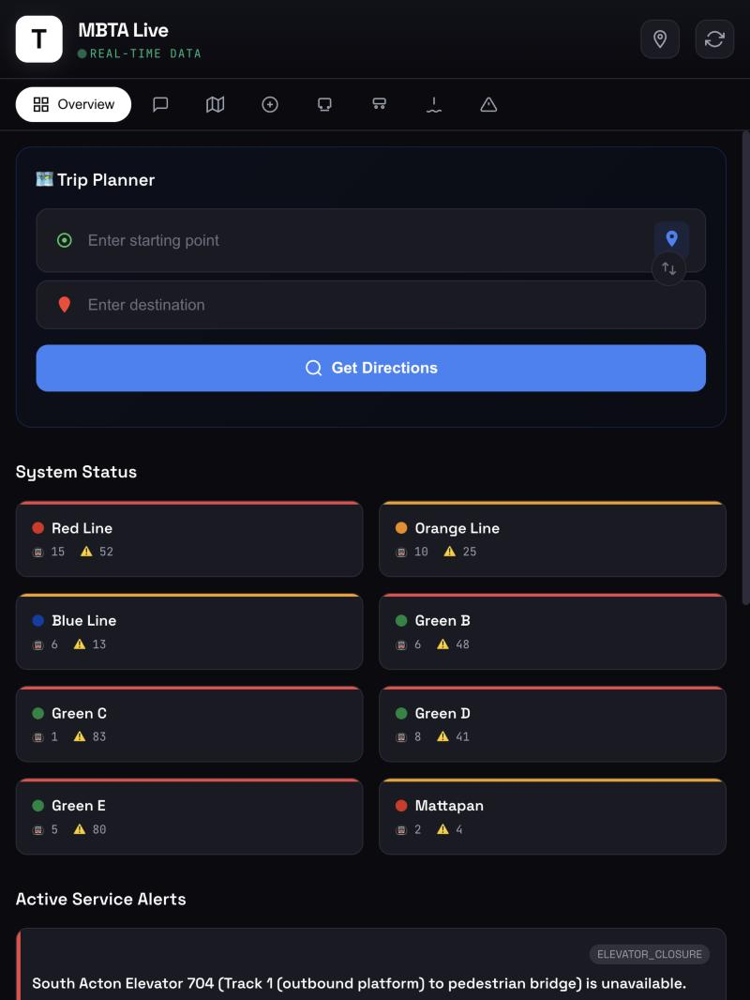 | 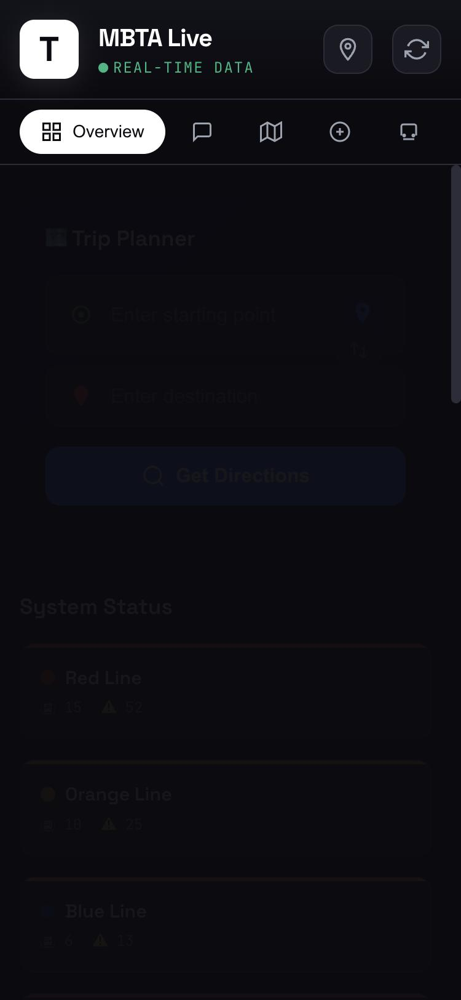 |

The design audit behind the redesign is in [`docs/design-audit.md`](docs/design-audit.md).
</details>

---

## How it works

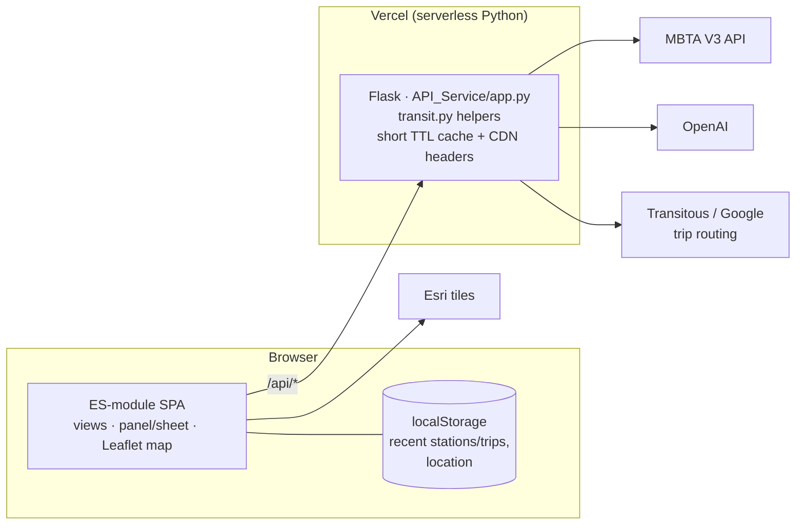

### Live data, honestly

- **One source of truth.** Arrivals, vehicles and alerts come from the MBTA V3 API through the Flask backend, which uses a short in-process cache (5–20 s; shapes and stops for longer) and CDN cache headers. Nothing is simulated.
- **Arrival order.** Arrivals are sorted by the time that's shown: the arrival time, or the departure time for trains leaving a terminal such as Oak Grove. Departed, cancelled and skipped trips are dropped. "Boarding" appears only when the MBTA reports that status.
- **Line status counts distinct, currently active service alerts of severity 3 or higher.** An alert used to be counted once per affected stop, so the Red Line showed "52 alerts". Elevator and escalator outages, and informational notices (severity 1–2), don't change a line's status.
- **Vehicles stay where the MBTA last reported them.** Markers move only on each refresh (about every 10 s); there's no movement interpolation. If a refresh fails, the last positions stay on screen with a "Couldn't refresh" note, and polling pauses when the map isn't visible.
- **Trip options are ordered by total travel time.** "Shortest trip" and "Fewest transfers" badges follow transparent rules, explained in their tooltips.

### Frontend structure (no build step)

```
API_Service/
├── app.py                 Flask app: REST API, chatbot, trip planner
├── transit.py             Pure helpers: prediction timing/sorting, alert classification
├── templates/index.html   App shell (sidebar, command bar, tab bar, panel)
├── static/css/app.css     Design tokens + components + responsive rules
└── static/js/
    ├── main.js            Router, global search, freshness, location
    ├── core/              api · store · router · constants · format · search · alerts · polyline
    ├── ui/                components · combobox · panel · station-panel · trip-form · location · toast · icons
    ├── map/live-map.js    Leaflet controller (lazy-loaded): shapes, stations, vehicle diffing, polling
    └── views/             overview · map · trip · stations · lines · alerts · assistant
```

---

## Run it locally

You need Python 3.11+, a free [MBTA V3 API key](https://api-v3.mbta.com/), and an [OpenAI API key](https://platform.openai.com/api-keys) for the assistant.

```bash
git clone https://github.com/Gnanasudharsan/Charlie.git
cd Charlie/API_Service
python -m venv .venv && source .venv/bin/activate
pip install -r requirements.txt
```

Create `API_Service/.env` (it's git-ignored):

```env
MBTA_API_KEY=your_mbta_key
OPENAI_API_KEY=your_openai_key
# Optional: the trip planner falls back to Transitous without it
GOOGLE_MAPS_API_KEY=your_google_maps_key
```

```bash
python app.py        # → http://localhost:5001
```

| Variable | Required | Used for |
|---|---|---|
| `MBTA_API_KEY` | Recommended | Live predictions, vehicles and alerts. Without it, the MBTA allows only a small number of requests per minute, and the UI shows "Couldn't refresh" when it's rate-limited. |
| `OPENAI_API_KEY` | For chat | Charlie AI. Without it, chat runs in a basic fallback mode. |
| `GOOGLE_MAPS_API_KEY` | Optional | Google transit directions. Without it, the trip planner uses Transitous (free, no key). |

---

## Tests

```bash
cd API_Service
pip install pytest
python -m pytest                          # 18 backend tests (MBTA mocked, no network)
node --test tests/js/frontend.test.mjs    # 15 frontend logic tests (Node 20+)
```

- **Backend tests** cover prediction timing and sorting (departure-only, null, tie, UTC-offset, departed and cancelled cases), alert classification and priority, the honest line status, and that MBTA errors surface as errors rather than empty lists. They also check the station, line, dashboard, alerts, stations-list, chat and trip-planner endpoints, and that every module is served versioned (never stale).
- **Frontend tests** cover station search (every one of the 126 stations is found by name, plus partial and fuzzy queries), countdown states, alert filters and counts, polyline decoding, the router, trip ordering and badges, station mentions in AI replies, arrival grouping, and badge text contrast.
- **UI flows** were checked by hand in a real browser at 375, 390, 768, 1024 and 1440 px. These covered keyboard navigation, comboboxes, map selection and filters, the bottom sheet, and the error states.

---

## Deployment

Production runs on **[Vercel](https://vercel.com)** as a serverless Python function: **https://charlie-mbta.vercel.app**

- **Every push to `main` deploys.** The Vercel project is connected to this repo, with its Root Directory set to `API_Service`. Static assets are cache-busted with the commit SHA.
- **Secrets are Vercel environment variables.** `MBTA_API_KEY`, `OPENAI_API_KEY` and optionally `GOOGLE_MAPS_API_KEY`. Nothing secret is in the repo.
- **Zero config.** Vercel detects the Flask `app` in `app.py`, and `.vercelignore` keeps the tests out of the function bundle.

```bash
vercel link                                   # from the repo root
vercel env add MBTA_API_KEY --environment production
vercel env add OPENAI_API_KEY --environment production
vercel deploy --prod
```

<details>
<summary><b>Legacy: Google Cloud Run</b></summary>

The app was first deployed to Cloud Run with Docker (`API_Service/Dockerfile`) and GitHub Actions (`.github/workflows/deploy.yml`, `deploy-cloudrun.yml`). Those workflows now run only on manual dispatch. They need billing enabled on the GCP project and the `GCP_SA_KEY`, `MBTA_API_KEY` and `OPENAI_API_KEY` secrets.
</details>

---

## API reference

All endpoints return JSON. Base URL: `https://charlie-mbta.vercel.app`

| Method | Endpoint | Description |
|---|---|---|
| `GET` | `/health` | Service health and version |
| `GET` | `/api/dashboard` | Per-line status (distinct alerts, active service alerts, accessibility alerts, vehicles reporting) and severe alerts |
| `GET` | `/api/alerts` | All alerts, prioritized, with `active_now`, `active_period`, `modes`, `category` (`service`/`accessibility`), `url` |
| `GET` | `/api/station/<stop_id>` | Station details, accessibility, lines, time-sorted predictions (`time`, `event`, `status`, direction, platform) and active alerts |
| `GET` | `/api/line/<route_id>` | Line info, ordered `stations` with next trains per direction, sorted `predictions_by_stop`, vehicles and alerts |
| `GET` | `/api/vehicles?route=<ids>&limit=` | Live vehicle positions with bearing, headsign, current stop and report time |
| `GET` | `/api/shapes?route=<ids>` | Encoded route polylines for the map |
| `GET` | `/api/stations` | All 126 stations with coordinates and lines |
| `GET` | `/api/routes` | Routes grouped by mode |
| `GET` | `/api/predictions?stop=<id>` | Upcoming predictions at a stop (or `?route=<id>`) |
| `GET` | `/api/nearest-station?lat=&lon=` | Nearest station to a coordinate |
| `POST` | `/api/set-location` | Resolve a coordinate to its nearest station |
| `POST` | `/api/trip-planner` | Directions. Body: `{ origin, destination, origin_coords?, dest_coords? }` |
| `POST` | `/api/chat` | Assistant. Body: `{ message, history?, location? }`; returns `{ reply, history }` |

Changes to the API only add fields; existing field names are unchanged.

---

## Known limitations

- **Trip legs aren't drawn on the map.** The routing response's leg geometry isn't passed through yet. Fares are estimates.
- **Bus, Commuter Rail and ferry vehicles appear only in route-focus mode.** The main map shows subway and light rail; open a route's page and choose "Show on live map" to see its vehicles.
- **Commuter Rail and ferry service is mostly scheduled.** Live predictions appear only when the MBTA publishes them.
- **Assistant replies are plain text.** Station and line chips are detected from the reply text, not from structured data.
- **Dark theme only.** No Playwright suite yet; UI flows were verified manually in the browser.
- **The ML model isn't used by the live app.** The delay-prediction model in [`Model_Development/`](Model_Development/readme.md) is part of the offline pipeline below.

---

## MLOps pipeline (offline)

The repo also contains the course MLOps pipeline that predicts train-delay probability from MBTA event data. **It runs separately from the live web app.**

| Stage | Where | What |
|---|---|---|
| Data pipeline | [`Data_Pipeline/`](Data_Pipeline/readme.md) | Airflow DAGs to collect, process and validate MBTA data (TFDV and Great Expectations), with DVC versioning and Fairlearn bias checks |
| Model development | [`Model_Development/`](Model_Development/readme.md) | Logistic Regression and LightGBM, tuning with SMOTE, MLflow tracking, SHAP and LIME, fairness, Evidently drift. Tuned Logistic Regression was selected (ROC-AUC **0.81**, per `reports/model_comparison.json`) |
| Monitoring & retraining | [`monitoring/`](monitoring/README.md), [`retraining/`](retraining/) | Prometheus-style metrics. Retraining triggers on PSI drift and promotes a model only if its AUC improves |
| CI | [`.github/workflows/charlie_mbta_ci.yml`](.github/workflows/charlie_mbta_ci.yml) | Train, tune, select, register, run bias, explainability and drift checks, and upload the reports |

---

## Acknowledgements

- Transit data from the [MBTA V3 API](https://www.mbta.com/developers/v3-api). Charlie is not affiliated with the MBTA.
- Trip routing by [Transitous](https://transitous.org), built on [MOTIS](https://github.com/motis-project/motis) and open GTFS data.
- Map tiles © [Esri](https://www.esri.com) — Esri, HERE, Garmin, FAO, NOAA, USGS, © OpenStreetMap contributors.
- Built for **IE 7374 — MLOps** at Northeastern University (Group 22).

Released under the [MIT License](LICENSE).
